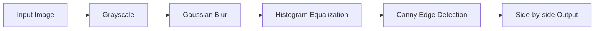

# Image Enhancement Using OpenCV

Explore a clear, step-by-step image enhancement pipeline in Python.

  

Pixelrefine loads an image, reduces noise, improves grayscale contrast, and highlights edges. It displays the original and every processed stage together, and saves the processed images as PNG files by default.

## Features

- 🖼️ Select an image with a file dialog or pass a path on the command line.
- 🧹 Reduce image noise with a configurable Gaussian kernel.
- ☀️ Improve grayscale contrast with histogram equalization.
- 🔎 Detect edges with configurable Canny thresholds.
- 📊 Compare all five stages in one Matplotlib window.
- 💾 Save processed results to `images/output/`, or use `--no-save`.

## Pipeline



## Demo


Add a screenshot of the five-panel result at `docs/screenshots/demo.png` to replace this placeholder.

| Step | OpenCV function | Purpose | Default parameters |
| --- | --- | --- | --- |
| Grayscale | `cv2.cvtColor` | Convert BGR color to one brightness channel | `cv2.COLOR_BGR2GRAY` |
| Gaussian Blur | `cv2.GaussianBlur` | Smooth noise before contrast and edge detection | 5 × 5 kernel, sigma 0 |
| Histogram Equalization | `cv2.equalizeHist` | Spread brightness values to improve contrast | Applied to blurred grayscale image |
| Canny Edge Detection | `cv2.Canny` | Highlight strong image boundaries | Low 100, high 200 |
| Side-by-side Output | `cv2.cvtColor`, Matplotlib `imshow` | Show original and each processed stage | 1 row, 5 panels; BGR to RGB for original |

## Project structure

```text
pixelrefine/
├── README.md
├── requirements.txt
├── .gitignore
├── LICENSE
├── main.py
├── image_enhancement/
│   ├── __init__.py
│   ├── processing.py
│   └── display.py
├── images/
│   ├── input/
│   │   └── .gitkeep
│   └── output/
│       └── .gitkeep
├── docs/
│   └── screenshots/
│       └── .gitkeep
└── tests/
    └── test_processing.py
```

## Installation

Use Python 3.9 or newer. From the repository root, create a virtual environment and install the dependencies.

**Windows PowerShell**

```powershell
python -m venv venv
.\venv\Scripts\Activate.ps1
pip install -r requirements.txt
```

**macOS / Linux**

```bash
python3 -m venv venv
source venv/bin/activate
pip install -r requirements.txt
```

If PowerShell blocks activation, run `.\venv\Scripts\python.exe` instead of `python` in the commands below.

## Usage

**GUI file dialog:** Run `python main.py` from the repository root. The dialog opens in `images/input/` by default; you can browse to another folder. Canceling the dialog exits without processing an image.

**Command line:** Place a supported image in `images/input/`, then run:

```bash
python main.py --image images/input/sample.jpg
```

Absolute paths and paths relative to the current directory also work. Supported extensions are `.png`, `.jpg`, `.jpeg`, `.bmp`, `.tif`, `.tiff`, and `.webp`. The program reports missing, unsupported, or unreadable files.

| Option | Description | Default |
| --- | --- | --- |
| `--image PATH` | Input image path; omit to open the file dialog | File dialog |
| `--kernel N` | Positive odd Gaussian kernel size | `5` |
| `--low N` | Lower Canny threshold | `100` |
| `--high N` | Upper Canny threshold | `200` |
| `--no-save` | Display results without writing PNG files | Save files |

Thresholds must satisfy `0 <= --low < --high <= 255`. For example:

```bash
python main.py --image images/input/sample.jpg --kernel 7 --low 80 --high 180 --no-save
```

Without `--no-save`, the program writes `<input-name>_grayscale.png`, `<input-name>_blurred.png`, `<input-name>_equalized.png`, and `<input-name>_edges.png` to `images/output/`.

## How it works

**Gaussian Blur.** A Gaussian kernel averages nearby grayscale pixels, reducing small variations and noise. The default kernel is 5 × 5; larger odd sizes smooth more strongly.

**Histogram Equalization.** `cv2.equalizeHist` redistributes the brightness values of the blurred grayscale image. This can reveal detail when the original image has a narrow range of brightness values.

**Canny Edge Detection.** `cv2.Canny` uses a low and high threshold to find connected image edges. Here it runs on the equalized result, and its output is a single-channel edge map.

## Running tests

```bash
python -m pytest
```

To try the full program, put an image at `images/input/sample.jpg`, run `python main.py --image images/input/sample.jpg`, and check the five-panel window and four PNGs in `images/output/`.

## Tech stack

Python 3.9+, OpenCV, NumPy, Matplotlib, tkinter (Python standard library), and pytest for tests.

## Future improvements

- Webcam input
- Streamlit GUI
- CLAHE contrast enhancement
- Adjustable processing sliders

## License

MIT. See [LICENSE](LICENSE).

## Author

Palak Singh ([palaksingh-git](https://github.com/palaksingh-git)).
